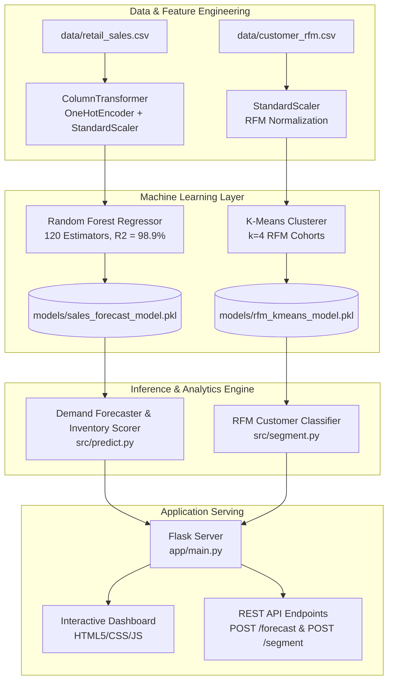

# 🛒 RetailMind: AI Retail Intelligence, Demand Forecasting & Customer Segmentation

[](https://www.python.org/)
[](https://flask.palletsprojects.com/)
[](https://scikit-learn.org/)
[](LICENSE)
[](#)

**RetailMind** is an enterprise Machine Learning and Decision Intelligence platform engineered for commercial retail. It provides high-accuracy sales demand forecasting (98.9% R²), inventory restock planning, and customer behavioral cohort clustering using Recency, Frequency, and Monetary (RFM) modeling.

---

## 🌟 Key Features

- **Predictive Demand & Revenue Forecasting:** Forecasts weekly unit demand and gross dollar revenue based on pricing, discounts, advertising spend, customer footfall, holiday surges, and merchandise category.
- **Dynamic Inventory Restock Planning:** Automatically computes suggested safety stock levels and reorder triggers to prevent stockouts and inventory shrinkage.
- **Customer RFM Segmentation:** Leverages K-Means clustering on purchase recency, transaction frequency, and cumulative spend to identify VIP Champions, Loyalists, and Churn Risk customers.
- **Actionable Promotion Personalization:** Maps behavioral customer segments directly to tailored discount incentives and marketing strategies.
- **Interactive Web Dashboard:** Clean, responsive analytics interface with operational scenario presets, KPI metric cards, and instant simulation tools.
- **RESTful API Service:** Production-ready endpoints for enterprise ERP / POS integration.

---

## 🏗️ System Architecture



---

## 📂 Repository Layout

```
RetailMind/
│
├── data/
│   ├── retail_sales.csv                 # 1,000 store transaction records across 5 categories
│   ├── customer_rfm.csv                 # 600 customer profiles with RFM behavioral metrics
│   └── README.md                        # Dataset documentation & feature dictionaries
│
├── notebooks/
│   ├── 01_EDA_Sales_Analysis.ipynb      # Sales trends, promotional elasticity, category revenue
│   └── 02_Model_Training.ipynb          # Demand regression & RFM clustering experiments
│
├── src/
│   ├── preprocess.py                    # Feature extraction & encoding pipeline
│   ├── train.py                         # Trains Random Forest and K-Means models
│   ├── predict.py                       # Sales forecasting inference & inventory rules
│   ├── segment.py                       # RFM customer segmentation engine
│   └── evaluate.py                      # R², RMSE, MAE, and Silhouette Score evaluation
│
├── models/
│   ├── sales_forecast_model.pkl         # Serialized Random Forest regression pipeline
│   └── rfm_kmeans_model.pkl             # Serialized K-Means customer segmentation pipeline
│
├── app/
│   ├── main.py                          # Flask web server & REST API routes
│   ├── templates/
│   │   └── index.html                   # Modern Retail Intelligence Dashboard
│   └── static/
│       ├── style.css                    # Professional dark theme stylesheet
│       └── script.js                    # Dynamic KPI meters & scenario preset handlers
│
├── requirements.txt                     # Dependencies
├── .gitignore                           # Git exclusions
├── LICENSE                              # MIT License
└── README.md                            # Documentation
```

---

## ⚡ Quickstart & Installation

### 1. Clone the Repository
```bash
git clone https://github.com/shakyasagar166/RetailMind.git
cd RetailMind
```

### 2. Set Up Virtual Environment
```bash
# On Windows (PowerShell)
python -m venv venv
.\venv\Scripts\Activate.ps1

# On macOS / Linux
python3 -m venv venv
source venv/bin/activate
```

### 3. Install Dependencies
```bash
pip install -r requirements.txt
```

---

## 🚀 Running the Pipeline

### 1. Re-train Models
```bash
python src/train.py --sales_data data/retail_sales.csv --rfm_data data/customer_rfm.csv --output models/
```

### 2. Evaluate System Performance
```bash
python src/evaluate.py
```

### 3. Test Sales Forecast via CLI
```bash
python src/predict.py --category Electronics --price 199.99 --discount 0.20 --holiday 1 --footfall 2400
```

### 4. Classify Customer RFM via CLI
```bash
python src/segment.py --recency 15 --frequency 25 --monetary 3500.0
```

---

## 🌐 Launching the Web Interface

Start the Flask application server:
```bash
python app/main.py
```

Open your browser and navigate to:
```
http://127.0.0.1:5002
```

### Dashboard Features:
- **Merchandise Demand Forecaster:** Test various pricing, discount rates, advertising budgets, and store footfall.
- **One-Click Operational Presets:** Test *"Holiday Super Sale"*, *"Weekend Apparel Promo"*, or *"Midweek Grocery Restock"*.
- **Customer Segmentation Simulator:** Enter recency, order frequency, and cumulative spend to inspect customer cohort classifications and suggested retention offers.
- **Recommended Machine Learning Programs:** Quick links to hands-on Machine Learning training programs.

---

## 📊 Model Performance Benchmarks

| Task | Algorithm | Metric | Score |
| :--- | :--- | :--- | :--- |
| **Sales Demand Forecasting** | Random Forest Regressor | **R² Fit** | **98.94%** |
| | | **Mean Absolute Error (MAE)** | **18.72 units** |
| | | **Mean Abs Percentage Err (MAPE)** | **3.80%** |
| **Customer Segmentation** | K-Means Clustering (k=4) | **Silhouette Score** | **0.496** |
| | | **Davies-Bouldin Index** | **0.637** |

---

## 📡 REST API Reference

### `POST /forecast`
Predicts weekly merchandise unit sales and gross revenue.

**Request Body:**
```json
{
  "store_id": 1,
  "category": "Electronics",
  "price": 149.99,
  "discount": 0.15,
  "customer_footfall": 2200,
  "advertising_spend": 1200.0,
  "is_holiday": 1,
  "is_weekend": 1,
  "month": 11
}
```

**Response Body:**
```json
{
  "success": true,
  "data": {
    "predicted_units": 485,
    "projected_revenue": 61830.11,
    "demand_status": "Moderate Demand",
    "status_color": "warning",
    "recommended_safety_stock": 606,
    "recommended_reorder_point": 218,
    "effective_price": 127.49
  }
}
```

### `POST /segment`
Classifies customer RFM profile into behavioral cohort.

**Request Body:**
```json
{
  "recency": 14,
  "frequency": 28,
  "monetary": 3600.0
}
```

### `GET /health`
Returns system uptime status (`{"status": "healthy"}`).

---

## 🎓 Recommended Machine Learning Training Programs

Looking to master Machine Learning, predictive analytics, and build enterprise retail applications like RetailMind? Explore premier, hands-on training courses from **Uncodemy**:

- 📍 **Delhi Center & Online:**  
  [Machine Learning Training Course in Delhi (Uncodemy)](https://uncodemy.com/course/machine-learning-training-course-in-delhi)  
  *Comprehensive curriculum covering Supervised & Unsupervised Learning, Regression pipelines, K-Means clustering, live enterprise projects, and 100% placement support.*

- 📍 **Noida Center & Online:**  
  [Machine Learning Training Course in Noida (Uncodemy)](https://uncodemy.com/course/machine-learning-training-course-in-noida)  
  *Industry-led hands-on training focusing on Python Scikit-Learn, PyTorch, model deployment with Flask APIs, MLOps, real-world retail capstones, and interview guarantee.*

---

## 📄 License
This project is open-source and distributed under the [MIT License](LICENSE).
